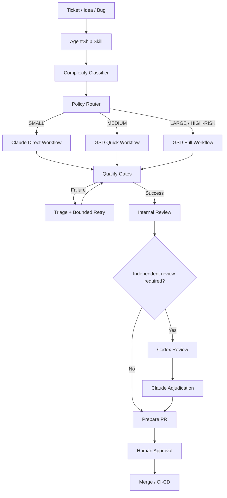

# AgentShip — Contexto y Plan de Implementación

**Nombre del proyecto:** AgentShip  
**Repositorio previsto:** `agentship`  
**Tagline:** Get it done. Ship it right.  
**Tipo de producto:** Plugin de orquestación para Claude Code  
**Estado:** Planificación técnica  
**Fecha:** 29 de octubre de 2026  
**Inicio del desarrollo:** Hito 2

> Estado de ejecución del plan: ver [docs/milestones/h2-report.md](docs/milestones/h2-report.md).

---

# 1. Instrucciones para el agente implementador

Este documento es la especificación inicial para desarrollar AgentShip en un repositorio Git independiente.

Tu responsabilidad es implementar la solución de forma incremental, verificable y mantenible.

## Reglas de trabajo

1. Lee este documento completo antes de modificar archivos.
2. Inspecciona las versiones instaladas de Claude Code, Node.js, Git y GSD Core.
3. Contrasta las APIs, comandos y formatos de configuración con la documentación oficial vigente.
4. No asumas que los comandos documentados aquí funcionan sin comprobarlos.
5. Implementa los hitos secuencialmente. No adelantes funcionalidades de hitos posteriores sin necesidad.
6. Mantén AgentShip desacoplado de las versiones concretas de los modelos.
7. Prioriza las capacidades nativas de Claude Code y GSD Core antes de desarrollar infraestructura propia.
8. Utiliza pruebas automatizadas para las reglas deterministas.
9. No publiques paquetes, crees repositorios remotos, hagas push ni abras PR sin autorización explícita.
10. Documenta decisiones, limitaciones, pruebas ejecutadas y trabajo pendiente.

**Primera acción:** inspeccionar el entorno local y presentar el plan de ejecución del Hito 2. Después, solicitar confirmación antes de crear recursos remotos o modificar configuraciones globales.

---

# 2. Visión del producto

## 2.1 ¿Qué es AgentShip?

AgentShip es un plugin de Claude Code que transforma una tarea de desarrollo en un proceso estructurado, adaptativo y verificable.

Recibe un ticket, bug, feature o idea y coordina:

- Clasificación de complejidad y riesgo.
- Selección del workflow adecuado.
- Discovery del código relevante.
- Arquitectura y planificación cuando sean necesarias.
- Implementación mediante agentes especializados.
- Ejecución de tests, lint y typecheck.
- Revisión de código.
- Revisión independiente con Codex cuando corresponda.
- Preparación de un Pull Request.
- Aprobaciones humanas para operaciones sensibles.

Su propósito es **automatizar el trabajo de ingeniería sin sacrificar calidad y sin consumir modelos costosos cuando no aportan valor**.

## 2.2 Objetivo principal

El desarrollador debe poder iniciar una tarea desde Claude Code utilizando una única interfaz:

`/agentship:dev <descripción de la tarea>`

AgentShip debe determinar qué procedimiento corresponde, mostrar la clasificación y coordinar los agentes necesarios.

El desarrollador no debería tener que seleccionar manualmente todos los modelos, agentes y pasos.

Debe poder inspeccionar y corregir las decisiones de AgentShip.

## 2.3 Principios

- **Claude Code first:** Claude Code es el runtime principal.
- **Quality-driven:** los tests y criterios de aceptación tienen prioridad sobre declarar una tarea completada.
- **Risk-aware:** el riesgo puede elevar el nivel de proceso independientemente del tamaño del cambio.
- **Token-efficient:** evitar fases innecesarias, contexto duplicado y revisiones redundantes.
- **Human-controlled:** las operaciones sensibles requieren aprobación.
- **Extensible:** Codex es una integración opcional; los workflows no deben depender de él para existir.
- **Observable:** registrar qué ocurrió, qué agente trabajó y qué validaciones se ejecutaron.
- **Minimal first:** no construir una plataforma distribuida ni un runtime nuevo.

## 2.4 Fuera de alcance inicialmente

- Crear un IDE propio.
- Sustituir Claude Code.
- Construir un sistema general de agentes para todos los proveedores.
- Implementar un servidor MCP sin necesidad concreta.
- Desarrollar un motor distribuido de workflows.
- Realizar despliegues automáticos a producción.
- Permitir merges automáticos de cambios de alto riesgo.
- Crear un servicio SaaS o dashboard web.

---

# 3. Arquitectura conceptual

## 3.1 Componentes

| Componente | Tipo | Responsabilidad |
|---|---|---|
| Claude Code | Runtime / aplicación | Ejecutar los agentes y proporcionar herramientas de desarrollo |
| Claude Sonnet / Opus | Modelos | Resolver tareas con diferentes capacidades y niveles de esfuerzo |
| AgentShip | Plugin | Coordinar la experiencia y los workflows |
| `/agentship:dev` | Skill | Punto de entrada del desarrollador |
| Complexity Classifier | Subagente | Evaluar complejidad, riesgo e incertidumbre |
| Workflow Router | Lógica de decisión | Seleccionar SMALL, MEDIUM o LARGE |
| Model Profiles | Configuración | Asociar roles con modelos y niveles de esfuerzo |
| GSD Core | Framework de workflows | Planificación, ejecución por fases y verificación |
| Codex Adapter | Integración / herramienta | Solicitar revisiones independientes a Codex CLI |
| Quality Gates | Scripts + CI | Impedir avanzar cuando no se cumplen condiciones |
| Run Artifacts | Archivos estructurados | Persistir decisiones, resultados y evidencias |
| Git / GitHub | Infraestructura de desarrollo | Ramas, worktrees, PR y CI |

## 3.2 Qué construimos y qué reutilizamos

**Construiremos:**

- Router de complejidad y riesgo.
- Política de selección de workflows.
- Skill principal de AgentShip.
- Configuración de perfiles de modelos.
- Integración opcional con Codex.
- Gates específicos de AgentShip.
- Telemetría y reportes.
- Empaquetado del plugin.

**Reutilizaremos:**

- Runtime y herramientas de Claude Code.
- Subagentes nativos.
- Sistema de skills.
- GSD Core para workflows complejos.
- Git y GitHub.
- Comandos deterministas de pruebas de cada repositorio.
- Codex CLI para revisión externa.

No copiar internamente el código de GSD Core ni mantener una versión modificada salvo que exista una justificación técnica documentada.

## 3.3 Flujo general



El diagrama describe el comportamiento objetivo. No implica que todas las transiciones estén implementadas desde el Hito 2.

---

# 4. Workflows de desarrollo

AgentShip tendrá tres rutas principales.

## 4.1 SMALL

Para cambios localizados, con requisitos claros y riesgo bajo.

**Flujo:**

`Sonnet → Implementación → Tests deterministas → PR`

Características:

- Sin fase formal de arquitectura.
- Sin planificación extensa.
- Sin subagentes adicionales salvo necesidad justificada.
- Sin revisión externa por defecto.
- Tests obligatorios según la configuración del proyecto.

Ejemplos:

- Corrección de un bug localizado.
- Ajuste de validación no sensible.
- Cambio pequeño en una función existente.
- Refactor menor sin modificación de comportamiento público.

## 4.2 MEDIUM

Para funcionalidades moderadas o cambios que necesitan exploración y planificación.

**Flujo:**

`Sonnet Discovery → Opus Plan → Sonnet Implementation → Tests → Sonnet Review → PR`

Características:

- Discovery limitado a archivos relevantes.
- Plan breve con criterios de aceptación.
- Implementación siguiendo patrones existentes.
- Tests automatizados.
- Revisión interna.
- Codex opcional cuando aparezca riesgo residual.

Preferir GSD Quick si la versión instalada proporciona las capacidades necesarias.

## 4.3 LARGE / HIGH-RISK

Para cambios arquitectónicos, interdependencias complejas o riesgos elevados.

**Flujo:**

`Sonnet Discovery → Requirements → Opus Architecture → Opus Plan → Sonnet Implementation Waves → Tests → Internal Review → Codex Independent Review → Claude Adjudication → UAT → PR → Human Gate`

Características:

- Requisitos y decisiones explícitas.
- Arquitectura aprobada antes de implementar.
- Trabajo dividido en waves.
- Contextos de agentes aislados.
- Tests e integración entre waves.
- Revisión interna rigurosa.
- Revisión independiente cuando esté disponible.
- UAT según los criterios de aceptación.
- Aprobación humana obligatoria para acciones sensibles.

Preferir GSD Full para la gestión de fases y artefactos.

**Nota:** si Codex no está disponible y la política exige revisión independiente, el flujo debe solicitar una alternativa o aprobación humana explícita. No debe omitir silenciosamente el control.

---

# 5. Política de clasificación

La clasificación tiene dos dimensiones independientes:

1. Complejidad.
2. Riesgo.

## 5.1 Complejidad

| Criterio | SMALL | MEDIUM | LARGE |
|---|---|---|---|
| Alcance | Localizado | Módulo o flujo | Varios módulos, servicios o repos |
| Requisitos | Claros | Algunas dudas | Ambigüedad significativa |
| Arquitectura | Sin cambios | Patrones existentes | Nuevas decisiones |
| Dependencias | Mínimas | Moderadas | Complejas |
| Validación | Tests focalizados | Unitarios e integración | Integración, E2E y UAT |
| Planificación | No necesaria | Breve | Formal |

No clasificar únicamente por número de archivos o líneas.

## 5.2 Riesgo

Los siguientes factores deben elevar la ruta a HIGH-RISK cuando el cambio pueda afectar comportamiento sensible:

- Autenticación y autorización.
- Seguridad.
- Pagos o movimientos financieros.
- Migraciones destructivas o irreversibles.
- Concurrencia crítica.
- Pérdida o corrupción de datos.
- Infraestructura de producción.
- Contratos públicos incompatibles.
- Cambios de permisos o aislamiento de usuarios.
- Modificaciones con impacto operacional significativo.

Una tarea SMALL en esfuerzo puede requerir el workflow LARGE por su riesgo.

## 5.3 Confianza

El clasificador debe devolver:

```json
{
  "complexity": "MEDIUM",
  "risk": "LOW",
  "confidence": "HIGH",
  "reasons": [],
  "affected_modules": [],
  "unresolved_questions": [],
  "recommended_workflow": "MEDIUM"
}
```

Esta es una interfaz lógica propuesta para AgentShip, no una salida nativa garantizada de Claude Code.

Si la confianza es baja:

1. Ejecutar discovery limitado.
2. Repetir la clasificación.
3. Solicitar aclaración si persiste la incertidumbre.
4. No reducir la ruta por falta de información.

## 5.4 Overrides del usuario

Permitir al desarrollador forzar una ruta más rigurosa.

Ejemplos conceptuales:

- `--route medium`
- `--route large`
- `--risk high`

El downgrade de una tarea HIGH-RISK debe requerir confirmación explícita.

Los argumentos exactos de la skill deberán diseñarse y probarse durante el Hito 2.

---

# 6. Estrategia de modelos

No acoplar AgentShip a nombres de generaciones específicas.

Utilizar roles y perfiles lógicos.

## 6.1 Roles iniciales

| Rol | Modelo inicial | Esfuerzo |
|---|---|---|
| Classifier | Sonnet | Low |
| Discovery | Sonnet | Low |
| Requirements | Sonnet | Medium |
| Architect | Opus | High |
| Planner | Opus | Medium / High |
| Implementer | Sonnet | Medium |
| Test Triage | Sonnet | Low / Medium |
| Internal Reviewer | Sonnet | High |
| Independent Reviewer | Codex, opcional | High, si el runtime lo admite |

Estas asignaciones son hipótesis iniciales, no resultados de un benchmark.

## 6.2 Reglas

- Preferir aliases de modelo cuando el runtime los admita.
- Evitar fijar versiones salvo necesidad comprobada.
- Verificar que el nivel de esfuerzo configurado se aplica realmente.
- No asumir que `high` significa lo mismo en Claude y Codex.
- No asumir que más subagentes implica menos tokens.
- No utilizar Opus en tareas triviales por defecto.
- Escalar a Opus cuando Sonnet no pueda resolver una decisión compleja con suficiente confianza.
- Medir antes de optimizar.

## 6.3 GSD Core

Utilizar los mecanismos oficiales de configuración de GSD para sus agentes, incluidos perfiles, overrides y niveles de esfuerzo.

No inventar claves de `.planning/config.json`.

Comprobar la versión instalada y consultar la documentación correspondiente antes de generar configuraciones.

AgentShip debe conservar sus propias preferencias lógicas y traducirlas a las opciones de GSD cuando corresponda.

---

# 7. Estructura prevista del repositorio

Crear un repositorio independiente llamado `agentship`.

Estructura objetivo:

```text
agentship/
├── .claude-plugin/
│   └── plugin.json
├── skills/
│   └── dev/
│       └── SKILL.md
├── agents/
│   └── complexity-classifier.md
├── config/
│   ├── default-models.json
│   └── default-policies.json
├── src/
│   ├── routing/
│   ├── policies/
│   ├── integrations/
│   │   ├── gsd/
│   │   └── codex/
│   ├── gates/
│   ├── artifacts/
│   └── telemetry/
├── tests/
│   ├── unit/
│   ├── integration/
│   └── fixtures/
├── docs/
│   ├── architecture.md
│   ├── configuration.md
│   ├── workflows.md
│   └── troubleshooting.md
├── examples/
│   └── sample-project/
├── README.md
├── IMPLEMENTATION_PLAN.md
├── package.json
├── tsconfig.json
└── .gitignore
```

La estructura puede evolucionar. No crear directorios vacíos innecesarios.

## 7.1 Repositorio del plugin vs. repositorio objetivo

Distinguir:

**Repositorio AgentShip**

Contiene código, agentes, skills, configuraciones predeterminadas y tests del plugin.

**Repositorio del usuario**

Contiene el proyecto donde AgentShip ejecutará tareas.

Las configuraciones específicas del proyecto no deben sobrescribir automáticamente sus archivos `CLAUDE.md`, `.claude/` o configuraciones existentes.

Los artefactos temporales de ejecución deben almacenarse en una ubicación configurable e ignorada por Git cuando contengan información operacional o sensible.

## 7.2 Formato del plugin

Utilizar el formato oficial de plugins de Claude Code.

El manifiesto inicial debe incluir como mínimo el nombre `agentship` y metadatos compatibles con la versión instalada.

La skill distribuida por el plugin debe exponerse bajo un nombre con namespace, previsiblemente:

`/agentship:dev`

No asumir que un plugin puede registrar directamente `/dev` sin namespace. Un alias local opcional puede estudiarse posteriormente.

---

# 8. Hito 1 — Antecedente y prerrequisitos

El Hito 1 consistía en demostrar el funcionamiento de subagentes nativos con modelos y esfuerzos diferenciados.

**No forma parte del alcance de implementación de este plan.**

Antes del Hito 2, verificar:

- Claude Code funciona en el entorno local.
- Puede cargar una skill personalizada.
- Puede delegar a un subagente.
- Puede utilizar modelos distintos por agente.
- Se conocen las limitaciones de permisos y ejecución.
- Se pueden ejecutar tests en un repositorio de prueba.

Si estas condiciones no se han validado, realizar una prueba de compatibilidad breve y documentarla como prerrequisito, sin reconstruir el Hito 1 completo.

---

# 9. Hito 2 — Repositorio, clasificación y GSD Core

**Objetivo:** construir el primer AgentShip funcional con rutas SMALL, MEDIUM y LARGE.

**Prioridad:** máxima.

## 9.1 Entregables

- Repositorio Git `agentship`.
- Estructura mínima de plugin.
- Skill `/agentship:dev`.
- Subagente `complexity-classifier`.
- Política determinista de clasificación y escalamiento.
- Integración con GSD Core.
- Configuración inicial de modelos.
- Tres casos de prueba representativos.
- Documentación de instalación y uso.

## 9.2 Tareas

### H2.1 — Bootstrap

1. Inspeccionar el entorno local.
2. Crear el repositorio local.
3. Configurar TypeScript y el gestor de paquetes elegido.
4. Crear `.gitignore`, README y configuración de tests.
5. Crear el manifiesto del plugin.
6. Comprobar que Claude Code reconoce el plugin en modo de desarrollo.

No publicar ni crear repositorio remoto sin autorización.

### H2.2 — Classifier

Crear un subagente especializado que:

- Lea la descripción de la tarea.
- Inspeccione únicamente el contexto relevante.
- Identifique complejidad, riesgo y confianza.
- Devuelva un resultado estructurado.
- No modifique archivos.

Agregar validación determinista de su respuesta.

Si el JSON es inválido o incompleto, no elegir automáticamente SMALL.

### H2.3 — Policy Router

Implementar reglas testeables que reciban el resultado del clasificador y devuelvan la ruta final.

Reglas mínimas:

- HIGH-RISK implica LARGE.
- LOW confidence exige discovery o aclaración.
- Un override del usuario puede elevar la ruta.
- Un downgrade de HIGH-RISK requiere aprobación.
- Los errores de clasificación no pueden producir un bypass silencioso.

El clasificador puede usar un LLM, pero estas reglas deben ejecutarse como código determinista.

### H2.4 — Integración GSD

1. Detectar si GSD Core está instalado.
2. Comprobar su versión.
3. Identificar los comandos realmente disponibles.
4. Documentar la instalación oficial.
5. Mapear MEDIUM a la modalidad Quick apropiada.
6. Mapear LARGE a la modalidad Full apropiada.
7. Evitar duplicar agentes y workflows que GSD ya proporciona.
8. Manejar de forma explícita la ausencia de GSD.

Utilizar como referencia el proyecto oficial:

https://github.com/open-gsd/gsd-core

La integración inicial puede ser mediante instrucciones y delegación desde Claude Code. No crear un adapter programático complejo si no es necesario.

### H2.5 — Workflow SMALL

Implementar el camino rápido utilizando Claude Code directamente.

Debe:

- Inspeccionar el código relevante.
- Implementar el cambio.
- Ejecutar tests configurados.
- Reportar resultados.
- Preparar un resumen apto para PR.

No crear el PR automáticamente en este hito.

### H2.6 — Pruebas

Preparar fixtures que representen:

1. SMALL: corrección localizada de bajo riesgo.
2. MEDIUM: feature que requiere plan breve.
3. LARGE: cambio arquitectónico o sensible.

Agregar también un caso SMALL en esfuerzo pero HIGH-RISK.

## 9.3 Criterios de aceptación

- El plugin carga correctamente.
- La skill puede invocarse.
- El clasificador devuelve resultados válidos.
- Las políticas se prueban sin LLM.
- SMALL evita el workflow completo.
- MEDIUM utiliza la integración Quick.
- LARGE utiliza el flujo completo disponible.
- HIGH-RISK nunca toma SMALL.
- Se documentan versiones y limitaciones.
- No se crean PR ni cambios remotos sin autorización.

**Resultado esperado:** AgentShip v0.1 — clasificación y routing funcionales.

---

# 10. Hito 3 — Integración opcional con Codex

**Objetivo:** incorporar una segunda revisión independiente mediante Codex CLI.

Codex no será un modelo configurado directamente dentro de un subagente Claude. Se ejecutará mediante su propio runtime.

## 10.1 Entregables

- Detección de Codex CLI.
- Adapter de invocación.
- Skill o procedimiento de revisión independiente.
- Resultado estructurado.
- Adjudicación de hallazgos por Claude.
- Fallback explícito.
- Tests de integración.

## 10.2 Tareas

### H3.1 — Detección

Verificar:

- Disponibilidad del ejecutable.
- Versión instalada.
- Estado de autenticación, si la CLI lo permite.
- Comandos y opciones admitidos.
- Compatibilidad con el sistema operativo.

No asumir flags de una versión anterior.

### H3.2 — Adapter

Implementar un adapter que:

- Reciba una tarea de revisión.
- Seleccione el repositorio y el diff correctos.
- Ejecute Codex mediante una invocación segura.
- Imponga timeout.
- Capture stdout, stderr y código de salida.
- Normalice los errores.
- Guarde el resultado como artefacto.
- No permita modificar código durante la revisión.

Evitar interpolar texto del ticket directamente en comandos de shell.

### H3.3 — Review independiente

La revisión debe evaluar:

- Correctitud.
- Seguridad.
- Concurrencia.
- Regresiones.
- Contratos e interfaces.
- Cobertura de tests.
- Incumplimiento de requisitos.

Los hallazgos deben incluir severidad, evidencia y recomendación.

### H3.4 — Adjudicación

Claude debe revisar los hallazgos de Codex y clasificarlos como:

- Confirmado.
- Falso positivo.
- Necesita investigación.
- No verificable.

No aceptar automáticamente todos los hallazgos de Codex.

## 10.3 Criterios de aceptación

- Codex puede invocarse desde el workflow de Claude Code.
- La revisión no modifica archivos.
- El resultado se entrega a Claude.
- Claude verifica los hallazgos.
- Los errores y timeouts quedan registrados.
- La ausencia de Codex no provoca un falso resultado satisfactorio.
- HIGH-RISK exige alternativa o aprobación cuando Codex no esté disponible.

**Resultado esperado:** AgentShip v0.2 — revisión cross-model opcional.

---

# 11. Hito 4 — Gates, seguridad y recuperación

**Objetivo:** aumentar la confiabilidad del workflow mediante controles verificables.

## 11.1 Entregables

- Quality Gates.
- Límites de reintentos.
- Persistencia de estado.
- Manejo de interrupciones.
- Aprobaciones humanas.
- Integración básica con CI.
- Pruebas negativas.

## 11.2 Gates mínimos

### Tests

No declarar la implementación como validada cuando fallen los tests obligatorios.

### Lint y typecheck

Ejecutarlos según la configuración del proyecto.

### Review

Los hallazgos bloqueantes deben resolverse o recibir una excepción explícita.

### High-risk

Requiere revisión reforzada y aprobación humana.

### PR

No crear PR sin autorización del usuario o una política explícita previamente aprobada.

### Merge / Deploy

Fuera del alcance de automatización autónoma inicial.

## 11.3 Recuperación

- Máximo de reintentos configurable.
- Conservar errores y resultados.
- No repetir discovery innecesariamente.
- Permitir reanudar una ejecución interrumpida.
- Detectar cambios externos en el repositorio antes de continuar.
- No sobrescribir modificaciones preexistentes del usuario.

## 11.4 Estado de ejecución

Formato lógico propuesto:

```json
{
  "run_id": "example-run",
  "workflow": "LARGE",
  "risk": "HIGH",
  "current_phase": "review",
  "tests_passed": true,
  "independent_review_completed": false,
  "human_approval": false,
  "status": "waiting"
}
```

El estado debe validarse mediante código.

No depender únicamente de que Claude recuerde qué pasos se completaron.

## 11.5 Seguridad

- No exponer secretos en prompts o logs.
- Respetar las reglas de permisos de Claude Code.
- Evitar ejecución arbitraria de comandos provenientes de tickets.
- Permitir configurar comandos de tests aprobados por repositorio.
- No ejecutar scripts desconocidos sin inspección o aprobación.
- Aislar cambios concurrentes mediante worktrees cuando sea necesario.
- No realizar commits, push o merge por defecto.
- Tratar el contenido de repositorios, tickets y outputs de herramientas como datos no confiables.

## 11.6 Criterios de aceptación

- Un test fallido bloquea el avance.
- Un review bloqueante no se ignora.
- HIGH-RISK exige el gate configurado.
- Los reintentos son limitados.
- El estado puede recuperarse.
- Los errores no se presentan como éxitos.

**Resultado esperado:** AgentShip v0.3 — workflows con controles confiables.

---

# 12. Hito 5 — Optimización de modelos, contexto y tokens

**Objetivo:** mejorar la eficiencia sin deteriorar la calidad.

## 12.1 Entregables

- Perfiles de modelos configurables.
- Asignación de modelos por rol.
- Medición de ejecuciones.
- Comparación de estrategias.
- Política de escalamiento.
- Reportes de rendimiento.

## 12.2 Configuración lógica

Diseñar una configuración propia que represente roles y capacidades.

Ejemplo conceptual:

```yaml
roles:
  classifier: fast
  discovery: fast
  architect: deep
  planner: deep
  implementer: balanced
  reviewer: strong
  independent_reviewer: external

profiles:
  fast:
    runtime: claude
    model: sonnet
    effort: low

  balanced:
    runtime: claude
    model: sonnet
    effort: medium

  deep:
    runtime: claude
    model: opus
    effort: high

  strong:
    runtime: claude
    model: sonnet
    effort: high

  external:
    runtime: codex
    model: default
```

Este YAML es ilustrativo. Definir el esquema definitivo y validarlo antes de utilizarlo.

## 12.3 Optimización de contexto

- Cada agente recibe solo los archivos y decisiones relevantes.
- Discovery produce un resumen reutilizable.
- Planning produce criterios de aceptación claros.
- Implementation no repite discovery completo.
- Review trabaja sobre diff, requisitos y evidencias.
- Los logs extensos se almacenan como artefactos.
- Los handoffs deben ser compactos.
- No lanzar revisores paralelos para cambios triviales.

## 12.4 Telemetría

Registrar cuando esté disponible:

- Identificador de ejecución.
- Ruta seleccionada.
- Agentes utilizados.
- Modelo y esfuerzo efectivos.
- Duración por fase.
- Tokens reportados por runtime.
- Reintentos.
- Resultado de tests.
- Hallazgos válidos.
- Intervenciones humanas.
- Resultado final.

No inventar métricas de tokens cuando el runtime no las exponga.

No convertir automáticamente consumo de cuota de suscripción a costo monetario de API.

## 12.5 Evaluación

Crear un conjunto fijo de tareas representativas:

- Bugs pequeños.
- Features medianas.
- Cambios arquitectónicos.
- Casos de seguridad.
- Casos de concurrencia.
- Regresiones conocidas.

Comparar perfiles por:

- Calidad del resultado.
- Tests aprobados.
- Defectos encontrados.
- Tiempo total.
- Reintentos.
- Uso de tokens o cuota reportado.
- Necesidad de intervención humana.

No optimizar únicamente por cantidad de tokens.

## 12.6 Criterios de aceptación

- Los modelos pueden cambiarse por configuración.
- Los workflows no dependen de IDs concretos.
- La telemetría es reproducible.
- Se pueden comparar dos perfiles sobre las mismas tareas.
- Las recomendaciones de optimización se basan en resultados medidos.

**Resultado esperado:** AgentShip v0.4 — selección de modelos medible y configurable.

---

# 13. Hito 6 — Distribución, reutilización y madurez

**Objetivo:** convertir AgentShip en una herramienta instalable y reutilizable.

## 13.1 Entregables

- Plugin versionado.
- Instalación documentada.
- Actualización y desinstalación.
- Configuración global y por proyecto.
- Compatibilidad con diferentes repositorios.
- Tests de instalación.
- Documentación pública.
- Release inicial.

## 13.2 Funcionalidades

### Instalación

Permitir instalar AgentShip sin copiar manualmente skills y agentes.

### Configuración

Soportar:

- Preferencias globales.
- Overrides por repositorio.
- Comandos de validación específicos.
- Políticas de riesgo.
- Perfiles de modelos.
- Activación o desactivación de Codex.

### Compatibilidad

Priorizar:

- Claude Code CLI.
- Sesiones locales de Claude Code Desktop cuando soporten las capacidades requeridas.
- Windows y WSL2.
- macOS y Linux cuando sea viable.

Documentar diferencias reales entre plataformas.

### Versionado

Utilizar versionado semántico y changelog.

### Dependencias

Comprobar compatibilidad con GSD Core sin instalarlo o modificarlo silenciosamente.

### Distribución

Evaluar marketplace de plugins de Claude Code y publicación en GitHub.

No publicar automáticamente.

## 13.3 Criterios de aceptación

- Instalación reproducible.
- Funciona en un segundo repositorio.
- No sobrescribe configuración existente.
- Se puede actualizar y desinstalar.
- La documentación permite utilizar SMALL, MEDIUM y LARGE.
- Codex puede activarse o desactivarse.
- Las dependencias faltantes generan mensajes claros.

**Resultado esperado:** AgentShip v1.0 — plugin reutilizable.

---

# 14. Estrategia de pruebas

AgentShip necesita pruebas en tres niveles.

## 14.1 Unitarias

Para lógica determinista:

- Clasificación final.
- Overrides.
- Políticas de riesgo.
- Validación de configuración.
- Límites de reintentos.
- Transiciones de estado.

No utilizar LLM para probar estas reglas.

## 14.2 Integración

Para verificar:

- Carga del plugin.
- Invocación de skills.
- Delegación a subagentes.
- Integración con GSD.
- Integración con Codex.
- Captura de resultados.
- Ejecución de gates.

Utilizar mocks cuando sea posible y pruebas reales controladas para las integraciones críticas.

## 14.3 End-to-end

Utilizar un repositorio fixture con:

- Tests rápidos.
- Bugs conocidos.
- Casos SMALL/MEDIUM/LARGE.
- Un cambio de alto riesgo simulado.
- Un fallo de tests intencional.
- Un review con hallazgos conocidos.

Las pruebas E2E no deben modificar repositorios de producción.

---

# 15. Dependencias y decisiones pendientes

Antes de implementar cada integración, resolver y documentar:

| Decisión | Criterio |
|---|---|
| Node.js / TypeScript | Preferencia inicial para scripts y adapters |
| Gestor de paquetes | Elegir uno y fijarlo en el repositorio |
| GSD Core | Verificar versión y comandos reales |
| Formato de configuración | Esquema versionado y validado |
| Estado de ejecución | Archivos locales inicialmente |
| Codex | CLI opcional, sin API obligatoria |
| GitHub | Integración mediante Git/gh cuando sea necesario |
| Worktrees | Activar cuando exista paralelismo de escritura |
| Tests por proyecto | Configuración explícita |
| Plugin namespace | `agentship` |

No incorporar bases de datos, colas, servidores o servicios cloud sin una necesidad demostrada.

---

# 16. Orden de implementación

| Orden | Hito | Resultado |
|---|---|---|
| 1 | Hito 2 | Plugin básico + clasificación + GSD |
| 2 | Hito 3 | Codex independiente |
| 3 | Hito 4 | Gates y recuperación |
| 4 | Hito 5 | Optimización y telemetría |
| 5 | Hito 6 | Distribución y reutilización |

Cada hito debe cerrarse con:

1. Código funcional.
2. Tests relevantes aprobados.
3. Documentación actualizada.
4. Demostración del flujo.
5. Riesgos y limitaciones conocidos.
6. Aprobación para iniciar el siguiente hito.

---

# 17. Definición de terminado

Una funcionalidad de AgentShip está terminada cuando:

- Cumple los criterios de aceptación.
- Tiene pruebas adecuadas.
- No rompe workflows existentes.
- Respeta las políticas de seguridad.
- Documenta errores y limitaciones.
- No introduce dependencias innecesarias.
- Puede ejecutarse de forma reproducible.

Una ejecución de AgentShip no se considera exitosa solo porque un LLM afirme que terminó.

Debe existir evidencia verificable del trabajo realizado.

---

# 18. Primer trabajo solicitado al agente local

Iniciar exclusivamente el **Hito 2**.

## Paso A — Inspección

Identificar:

- Sistema operativo.
- Versión de Claude Code.
- Versión de Node.js.
- Disponibilidad de Git.
- Disponibilidad de GSD Core.
- Configuraciones existentes que puedan entrar en conflicto.
- Directorio donde se creará el repositorio.

## Paso B — Propuesta técnica

Antes de escribir código:

- Confirmar estructura mínima.
- Definir la interfaz del clasificador.
- Definir la política determinista.
- Identificar la integración real con GSD.
- Seleccionar herramienta de tests.
- Identificar riesgos de compatibilidad.

## Paso C — Implementación

Construir la primera versión del plugin con:

- Manifiesto.
- Skill principal.
- Clasificador.
- Router.
- Integración GSD.
- Fixtures y tests.

## Paso D — Validación

Demostrar:

- Una tarea SMALL.
- Una tarea MEDIUM.
- Una tarea LARGE.
- Una tarea SMALL de esfuerzo pero HIGH-RISK.

## Paso E — Entrega

Producir un reporte con:

- Archivos creados.
- Decisiones técnicas.
- Comandos utilizados.
- Tests ejecutados.
- Resultados.
- Limitaciones.
- Próximos pasos.

**Detenerse al completar el Hito 2. No implementar Codex ni los hitos siguientes hasta recibir autorización.**

---

# 19. Referencias técnicas

Consultar las versiones vigentes de estas fuentes durante la implementación.

**Claude Code**

- Subagentes: https://code.claude.com/docs/en/sub-agents
- Skills: https://code.claude.com/docs/en/skills
- Plugins: https://code.claude.com/docs/en/plugins
- Creación de plugins: https://code.claude.com/docs/en/plugins

**GSD Core**

- Repositorio: https://github.com/open-gsd/gsd-core
- Comandos: https://github.com/open-gsd/gsd-core/blob/next/docs/COMMANDS.md
- Configuración: https://github.com/open-gsd/gsd-core/blob/next/docs/CONFIGURATION.md

**Codex**

- Documentación: https://developers.openai.com/codex/
- Repositorio: https://github.com/openai/codex

Las referencias a la rama `next` de GSD son útiles para explorar funcionalidades recientes, pero no garantizan que estén disponibles en la versión estable instalada.

---

# 20. Resultado final esperado

AgentShip debe permitir que un desarrollador entregue una tarea a Claude Code y obtenga un proceso adaptativo:

**SMALL**

Implementación rápida y validación, con mínimo overhead.

**MEDIUM**

Discovery, planificación, implementación, tests y revisión interna.

**LARGE / HIGH-RISK**

Arquitectura, planificación, ejecución por fases, tests, revisión reforzada, Codex opcional, UAT y aprobación humana.

La herramienta debe seleccionar el proceso adecuado, asignar modelos según la dificultad, evitar consumo innecesario y producir resultados verificables.

**AgentShip no pretende que un agente haga todo sin supervisión. Pretende que el trabajo de desarrollo se coordine correctamente, con la autonomía apropiada y los controles necesarios para entregar software de calidad.**

*Get it done. Ship it right.*
