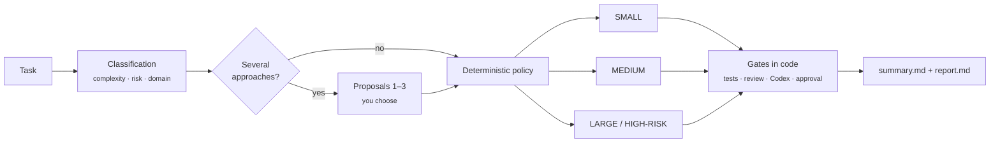

<div align="center">

# AgentShip

**Get it done. Ship it right.**

A Claude Code plugin that turns any development task into a structured, verifiable workflow, with a human in the loop where it matters.


[Quick start](#quick-start) · [How it works](#how-it-works) · [Usage](#usage) · [Configuration](docs/configuration.md) · [Documentation](#documentation)

</div>

---

## Why AgentShip

Asking an agent to "fix this" is fine for a one-line change. It gets risky when the change touches payments, permissions, or half a dozen modules. AgentShip decides **how much process each task needs**, then **enforces that process in code**, not by good intentions:

- 🧭 **Classifies** every task by complexity, risk and domain, and routes it accordingly.
- 💡 **Proposes** up to 3 approaches when there is more than one reasonable path. You pick.
- 🧑‍🔬 **Calls domain specialists** (accounting, payments, auth, security…), each on the model that fits its phase.
- 🚦 **Enforces gates in code**: passing tests, a review with no blocking findings, human approval. If anything is missing, the run is `blocked`, never "done".
- 🔍 **Gets a second opinion** from Codex, which reviews the diff read-only. Claude verifies every finding before accepting it.
- ♻️ **Is resumable and measurable**: state lives on disk, model profiles are configurable, and every run leaves a report.

> AgentShip **never** commits, pushes, opens PRs or deploys. It leaves the changes in your working tree, plus a PR-ready `summary.md`.

## Quick start

```bash
claude plugin marketplace add dong4to/agentship
claude plugin install agentship@agentship
```

Open Claude Code in your project and run:

```text
/agentship:dev applyDiscount accepts percentages > 100; clamp it to 0-100
```

To check your environment (Node, git, Codex, configuration, test command and specialists), use the plugin path shown by `claude plugin list`:

```bash
node <plugin-path>/src/cli.ts doctor --project .
```

## How it works



An LLM classifies the task, but **the route is decided by deterministic, tested code**. HIGH risk always ends up LARGE, an invalid classification never falls back to SMALL, and lowering the route of a HIGH-risk task needs explicit confirmation.

| Route | When | Phases |
|---|---|---|
| **SMALL** | Localized change, clear requirements, low risk | implement → tests → summary |
| **MEDIUM** | One-module feature, short plan | discovery → plan → waves → tests → review → *Codex if applicable* → summary |
| **LARGE / HIGH-RISK** | Several modules, new decisions, or high risk | discovery → research → requirements → plan → **human approval** → waves → tests → review → **Codex** → UAT → summary |

<details>
<summary><b>What each gate requires</b></summary>

| Gate | Passes when |
|---|---|
| Tests | The last `run test` exited 0. Lint and typecheck pass if the project declares them. |
| Review | The latest round has no HIGH finding and no `NOT_MET` criterion, unless you approved an exception for it. |
| Codex | The review is `complete`, every finding is adjudicated, and nothing is blocking. If Codex is unavailable and the review is required, you decide: a Claude fallback review, or waiving it. |
| Human gate | You approved the plan, in the conversation or with `--resume <id> --approve`. |
| Implementation | `tree-check` passes: nobody moved HEAD, and the plan doesn't touch files you were already editing. |

Full details are in [docs/workflows.md](docs/workflows.md).
</details>

## Usage

```text
/agentship:dev <task>
/agentship:dev --risk high change who can issue refunds
/agentship:dev --profile economy add a health endpoint
/agentship:dev --resume 2026-11-12T10-00-00-000Z --approve
```

| Flag | Effect |
|---|---|
| `--route small\|medium\|large` | Raises the route. It can only lower it when the risk is not HIGH. |
| `--risk high` | Marks the task HIGH, which forces LARGE. Risk can never be lowered. |
| `--confirm-downgrade` | Confirms lowering a HIGH-risk task. Even then, the minimum is MEDIUM. |
| `--proposals` / `--no-proposals` | Forces or skips the proposals phase. |
| `--profile balanced\|economy\|quality` | Picks the model profile for this run. |
| `--resume <id> [answers]` | Resumes a run at its pending phase. Any text after the id is your answer to its questions. |
| `--resume <id> --proposal <n>` | Picks a proposal. |
| `--resume <id> --approve` | Approves the human gate from another session. |

### What a run looks like

```text
Route     SMALL · risk LOW · confidence HIGH · profile balanced
Phases    implement ✔  test ✔  summary ✔
Tests     npm test → exit 0  (logs/test-final.log)
Changed   src/cart.js, test/cart.test.js
Evidence  .agentship/runs/2026-11-13T00-22-15-784Z/  → summary.md · report.md
```

Each run keeps its evidence in `<project>/.agentship/runs/<id>/`. The folder ignores itself, so AgentShip never touches your project's `.gitignore`. It holds:

- the classification and proposals;
- the plan;
- `state.json`;
- the check logs;
- the reviews, one folder per round;
- the Codex review and its adjudication;
- `summary.md` (PR-ready) and `report.md` (durations, agents, models, reported tokens, retries and human interventions).

## Security by design

- **Task text never goes through a shell.** It is written to files that the CLI reads.
- **Only commands you approved are run**, as that exact command line and per project. Approvals are stored outside the repository, so a repo cannot approve itself.
- **Approvals always go through a Claude Code permission prompt.** The skill cannot record one on its own.
- **Project configuration can only tighten the policy**, never relax it.
- **Codex reviews in a read-only sandbox.** If it is found to have modified any file, its review is discarded.

## Requirements

| | Version | |
|---|---|---|
| Claude Code | ≥ 2.1.292 | tested with 2.1.312 |
| Node.js | ≥ 22.18 | runs TypeScript without a build step |
| git | recent | diffs and external-change detection |
| Codex CLI | optional | independent review (tested with 0.145.0) |
| Specialists | optional | e.g. [VoltAgent](https://github.com/VoltAgent/awesome-claude-code-subagents) or your own `.claude/agents/` |

Windows, macOS, Linux and WSL2: see [compatibility](docs/compatibility.md).

## Installation

```bash
# Install
claude plugin marketplace add dong4to/agentship
claude plugin install agentship@agentship

# Update
claude plugin marketplace update agentship
claude plugin update agentship@agentship

# Uninstall
claude plugin uninstall agentship@agentship
```

To try it in a single session without installing: `claude --plugin-dir /path/to/agentship`.

<details>
<summary><b>Agent-assisted installation</b></summary>

Paste this prompt into a Claude Code session opened in any folder **other than** AgentShip's. The agent checks the requirements, installs the plugin and verifies it, and asks you before any global change.

```text
Install and set up the Claude Code plugin "AgentShip" (repo: https://github.com/dong4to/agentship).
Follow these steps in order and stop if one fails:

1. Requirements. Show me the output of `claude --version` (>= 2.1.292), `node --version` (>= 22.18),
   `git --version` and `gh auth status` (the repo is private). If anything is missing, stop and tell me
   how to update it; don't install it yourself.

2. Loading mode. Ask me which I prefer:
   a) Per session, no global changes: clone with `gh repo clone dong4to/agentship <path>` into a tools
      folder and start Claude Code with `claude --plugin-dir <path>`.
   b) In every session: `claude plugin marketplace add dong4to/agentship` and
      `claude plugin install agentship@agentship`. This changes my user configuration: confirm with me
      first.
   Don't put AgentShip inside a project where I'll use it: Claude Code write-protects files under a
   plugin's root.

3. Check that it loads (`claude plugin list`, or `claude --plugin-dir <path> plugin list`) and run
   `node <plugin-path>/src/cli.ts doctor --project <my-project>`. Show me the result.

4. Codex (optional). If `doctor` says Codex is unavailable, explain why. If my Codex model isn't
   supported, suggest `codex.model` in `~/.claude/agentship/config.json`, but don't write it without my OK.

5. Specialists (optional). Ask whether I want to install VoltAgent categories
   (https://github.com/VoltAgent/awesome-claude-code-subagents). Recommend only a few, e.g.
   `voltagent-domains` or `voltagent-qa-sec`. This is a global change: only with my confirmation.

6. Report what you installed and where, what is still pending, and how to start
   (`/agentship:dev <task>`; `/reload-plugins` if the session was already open).

Rules: don't modify my CLAUDE.md, `settings.json` or my projects' `.claude/`; don't push or create
repos; don't use `bypassPermissions`.
```
</details>

## Configuration

AgentShip works with no configuration. To tune it there are two files:

| File | Purpose |
|---|---|
| `~/.claude/agentship/config.json` | Your preferences: model profile, tiers, retries, Codex, policies |
| `<project>/agentship.config.json` | Project settings: test, lint and typecheck commands, custom domains, and **stricter** policies |

```json
{
  "model_profile": "balanced",
  "codex": { "enabled": "auto", "model": "gpt-5.6-sol", "timeout_seconds": 900 },
  "retries": { "tests_per_wave": 2, "review_rounds": 1 }
}
```

`node <plugin>/src/cli.ts config --project .` prints the effective configuration and any errors. The full reference is in [docs/configuration.md](docs/configuration.md).

## Development

```bash
npm install
npm run check        # typecheck + 91 tests (no LLM) + claude plugin validate --strict
```

| Script | What it tests |
|---|---|
| `tests/e2e/setup-fixture.sh <dir>` | Builds the sample project as a throwaway git repo, **outside** the plugin repo. |
| `tests/e2e/run-e2e.sh <fixture> <out>` | Runs all 4 routes headless with real Claude. |
| `tests/e2e/install-test.sh` | Installs, updates and uninstalls in a temporary `CLAUDE_CONFIG_DIR`. |
| `tests/e2e/run-eval.sh <fixture> <out> balanced economy` | Compares model profiles on 6 fixed tasks (uses model quota). |

Code layout and design decisions are in [docs/architecture.md](docs/architecture.md).

## Documentation

The detailed documentation is in Spanish.

| | |
|---|---|
| [Architecture](docs/architecture.md) | Components, flow and decisions |
| [Workflows](docs/workflows.md) | Routing policy, phases, gates, retries and recovery |
| [Configuration](docs/configuration.md) | Every key, profiles, commands and specialists |
| [Compatibility](docs/compatibility.md) | Platforms, versions and known differences |
| [Troubleshooting](docs/troubleshooting.md) | Symptoms, causes and fixes |
| [CHANGELOG](CHANGELOG.md) | Version history |
| [Implementation plan](IMPLEMENTATION_PLAN.md) | Original specification and revisions |

## License

Not yet chosen by the author.
