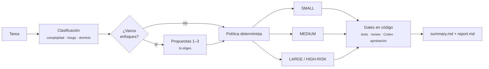

<div align="center">

# AgentShip

**Get it done. Ship it right.**

Un plugin de Claude Code que convierte cualquier tarea de desarrollo en un flujo estructurado, verificable y con humanos en los puntos que importan.


[Inicio rápido](#inicio-rápido) · [Cómo funciona](#cómo-funciona) · [Uso](#uso) · [Configuración](docs/configuration.md) · [Documentación](#documentación)

</div>

---

## Por qué AgentShip

Pedirle a un agente "arregla esto" funciona bien para un cambio de una línea, pero tiene riesgos cuando el cambio toca pagos, permisos o media docena de módulos. AgentShip decide **cuánto proceso necesita cada tarea** y después **hace cumplir ese proceso con código**, no con buenas intenciones:

- 🧭 **Clasifica** cada tarea por complejidad, riesgo y dominio, y la envía a la ruta adecuada.
- 💡 **Propone** hasta 3 enfoques cuando hay más de un camino razonable. Tú eliges.
- 🧑‍🔬 **Llama a especialistas** del dominio (contabilidad, pagos, auth, seguridad…), cada uno con el modelo que corresponde a su fase.
- 🚦 **Hace cumplir los gates en código**: tests en verde, revisión sin bloqueantes y aprobación humana. Si falta algo, la ejecución queda `blocked`, nunca "completada".
- 🔍 **Pide una segunda opinión** a Codex: revisa el diff en modo read-only, y Claude verifica cada hallazgo antes de aceptarlo.
- ♻️ **Es reanudable y medible**: el estado vive en disco, hay perfiles de modelos y cada ejecución deja un reporte.

> AgentShip **nunca** hace commit, push, PR ni deploy. Deja los cambios en tu working tree y un `summary.md` listo para el PR.

## Inicio rápido

```bash
claude plugin marketplace add dong4to/agentship
claude plugin install agentship@agentship
```

Abre Claude Code en tu proyecto y escribe:

```text
/agentship:dev applyDiscount acepta porcentajes > 100; limitarlo a 0-100
```

Para comprobar el entorno (Node, git, Codex, configuración, comando de tests y especialistas), usa la ruta del plugin que muestra `claude plugin list`:

```bash
node <ruta-del-plugin>/src/cli.ts doctor --project .
```

## Cómo funciona



Un LLM clasifica la tarea, pero **la ruta la decide código determinista y testeado**. El riesgo HIGH siempre termina en LARGE, una clasificación inválida nunca cae en SMALL, y bajar de ruta una tarea HIGH exige confirmación explícita.

| Ruta | Cuándo | Fases |
|---|---|---|
| **SMALL** | Cambio localizado, requisitos claros, riesgo bajo | implementar → tests → resumen |
| **MEDIUM** | Feature de un módulo, plan breve | discovery → plan → waves → tests → revisión → *Codex si aplica* → resumen |
| **LARGE / HIGH-RISK** | Varios módulos, decisiones nuevas o riesgo alto | discovery → research → requisitos → plan → **aprobación humana** → waves → tests → revisión → **Codex** → UAT → resumen |

<details>
<summary><b>Qué exige cada gate</b></summary>

| Gate | Condición para pasar |
|---|---|
| Tests | El último `run test` terminó con exit 0. Lint y typecheck pasan si el proyecto los declara. |
| Revisión | En la última ronda no queda ningún hallazgo HIGH ni criterio `NOT_MET` sin una excepción que tú hayas aprobado. |
| Codex | Revisión `complete`, con todos los hallazgos adjudicados y sin bloqueantes. Si Codex no está disponible y la revisión es obligatoria, decides tú: un fallback con Claude o renunciar a la revisión. |
| Gate humano | Aprobaste el plan, en la conversación o con `--resume <id> --approve`. |
| Implementación | `tree-check` sin errores: nadie movió HEAD y el plan no toca archivos que tú ya estabas editando. |

Todos los gates están en [docs/workflows.md](docs/workflows.md).
</details>

## Uso

```text
/agentship:dev <tarea>
/agentship:dev --risk high cambiar quién puede emitir reembolsos
/agentship:dev --profile economy agregar un endpoint de salud
/agentship:dev --resume 2026-11-12T10-00-00-000Z --approve
```

| Flag | Efecto |
|---|---|
| `--route small\|medium\|large` | Sube la ruta. Solo puede bajarla si el riesgo no es HIGH. |
| `--risk high` | Marca la tarea como HIGH, lo que fuerza LARGE. El riesgo nunca se puede bajar. |
| `--confirm-downgrade` | Confirma bajar una tarea HIGH. Incluso así, el mínimo es MEDIUM. |
| `--proposals` / `--no-proposals` | Fuerza o salta la fase de propuestas. |
| `--profile balanced\|economy\|quality` | Elige el perfil de modelos para esta ejecución. |
| `--resume <id> [respuestas]` | Retoma una ejecución en su fase pendiente; el texto que sigue son tus respuestas a sus preguntas. |
| `--resume <id> --proposal <n>` | Elige una propuesta. |
| `--resume <id> --approve` | Aprueba el gate humano desde otra sesión. |

### Así se ve una ejecución

```text
Route     SMALL · risk LOW · confidence HIGH · profile balanced
Phases    implement ✔  test ✔  summary ✔
Tests     npm test → exit 0  (logs/test-final.log)
Changed   src/cart.js, test/cart.test.js
Evidence  .agentship/runs/2026-11-13T00-22-15-784Z/  → summary.md · report.md
```

Cada ejecución guarda su evidencia en `<proyecto>/.agentship/runs/<id>/`. Esa carpeta se ignora a sí misma, así que AgentShip no toca el `.gitignore` del proyecto. Ahí quedan:

- la clasificación y las propuestas;
- el plan;
- `state.json`;
- los logs de los checks;
- las revisiones por ronda;
- la revisión de Codex y su adjudicación;
- `summary.md` (listo para el PR) y `report.md` (duraciones, agentes, modelos, tokens reportados, reintentos e intervenciones humanas).

## Seguridad por diseño

- **El texto de la tarea nunca pasa por el shell.** Se guarda en archivos que lee el CLI.
- **Solo se ejecutan los comandos que tú aprobaste**, línea exacta y por proyecto. La aprobación se guarda fuera del repositorio, para que un repo no pueda aprobarse a sí mismo.
- **Las aprobaciones pasan siempre por un prompt de permisos de Claude Code**: la skill no puede registrarlas por su cuenta.
- **La configuración del proyecto solo puede endurecer la política**, nunca relajarla.
- **Codex revisa en un sandbox read-only.** Si se detecta que modificó algún archivo, su revisión se descarta.

## Requisitos

| | Versión | |
|---|---|---|
| Claude Code | ≥ 2.1.292 | probado con 2.1.312 |
| Node.js | ≥ 22.18 | ejecuta TypeScript sin build |
| git | reciente | diffs y detección de cambios externos |
| Codex CLI | opcional | revisión independiente (probado con 0.145.0) |
| Especialistas | opcionales | p. ej. [VoltAgent](https://github.com/VoltAgent/awesome-claude-code-subagents) o tus propios `.claude/agents/` |

Windows, macOS, Linux y WSL2: ver [compatibilidad](docs/compatibility.md).

## Instalación

```bash
# Instalar
claude plugin marketplace add dong4to/agentship
claude plugin install agentship@agentship

# Actualizar
claude plugin marketplace update agentship
claude plugin update agentship@agentship

# Desinstalar
claude plugin uninstall agentship@agentship
```

Para probarlo en una sola sesión, sin instalarlo: `claude --plugin-dir /ruta/a/agentship`.

<details>
<summary><b>Instalación asistida por un agente</b></summary>

Pega este prompt en una sesión de Claude Code abierta en cualquier carpeta que **no** sea la de AgentShip. El agente comprueba los requisitos, instala el plugin y lo verifica, y te pide permiso antes de cualquier cambio global.

```text
Instala y configura el plugin de Claude Code "AgentShip" (repo: https://github.com/dong4to/agentship).
Sigue estos pasos en orden y no avances si uno falla:

1. Requisitos. Muéstrame las versiones de `claude --version` (>= 2.1.292), `node --version` (>= 22.18),
   `git --version` y `gh auth status` (el repo es privado). Si algo falta, detente y dime cómo
   actualizarlo; no lo instales por tu cuenta.

2. Modo de carga. Pregúntame cuál prefiero:
   a) Solo por sesión, sin cambios globales: clonar con `gh repo clone dong4to/agentship <ruta>` en una
      carpeta de herramientas y arrancar Claude Code con `claude --plugin-dir <ruta>`.
   b) En todas las sesiones: `claude plugin marketplace add dong4to/agentship` y
      `claude plugin install agentship@agentship`. Esto cambia mi configuración de usuario: confírmalo
      conmigo antes.
   No pongas AgentShip dentro de un proyecto donde lo vaya a usar: Claude Code protege contra escritura
   los archivos que están bajo la raíz de un plugin.

3. Verifica que carga (`claude plugin list`, o `claude --plugin-dir <ruta> plugin list`) y ejecuta
   `node <ruta-del-plugin>/src/cli.ts doctor --project <mi-proyecto>`. Muéstrame el resultado.

4. Codex (opcional). Si `doctor` dice que Codex no está disponible, explícame por qué. Si el modelo de mi
   Codex no está soportado, sugiéreme `codex.model` en `~/.claude/agentship/config.json`, pero no lo
   escribas sin mi OK.

5. Especialistas (opcional). Pregúntame si quiero instalar categorías de VoltAgent
   (https://github.com/VoltAgent/awesome-claude-code-subagents). Recomienda pocas, por ejemplo
   `voltagent-domains` o `voltagent-qa-sec`. Es un cambio global: hazlo solo con mi confirmación.

6. Reporta qué instalaste y dónde, qué quedó pendiente y cómo empezar (`/agentship:dev <tarea>`;
   `/reload-plugins` si la sesión ya estaba abierta).

Reglas: no modifiques mis CLAUDE.md, `settings.json` ni el `.claude/` de mis proyectos; no hagas push
ni crees repos; no uses `bypassPermissions`.
```
</details>

## Configuración

AgentShip funciona sin configurar nada. Para ajustarlo hay dos archivos:

| Archivo | Para qué |
|---|---|
| `~/.claude/agentship/config.json` | Tus preferencias: perfil de modelos, tiers, reintentos, Codex, políticas |
| `<proyecto>/agentship.config.json` | Lo del proyecto: comandos de test, lint y typecheck, dominios propios y políticas **más estrictas** |

```json
{
  "model_profile": "balanced",
  "codex": { "enabled": "auto", "model": "gpt-5.6-sol", "timeout_seconds": 900 },
  "retries": { "tests_per_wave": 2, "review_rounds": 1 }
}
```

`node <plugin>/src/cli.ts config --project .` muestra la configuración efectiva y sus errores. La referencia completa está en [docs/configuration.md](docs/configuration.md).

## Desarrollo

```bash
npm install
npm run check        # typecheck + 91 tests (sin LLM) + claude plugin validate --strict
```

| Script | Qué prueba |
|---|---|
| `tests/e2e/setup-fixture.sh <dir>` | Crea el proyecto de ejemplo en un repo git desechable, **fuera** del repo del plugin. |
| `tests/e2e/run-e2e.sh <fixture> <out>` | Corre las 4 rutas con Claude real en modo headless. |
| `tests/e2e/install-test.sh` | Instala, actualiza y desinstala en un `CLAUDE_CONFIG_DIR` temporal. |
| `tests/e2e/run-eval.sh <fixture> <out> balanced economy` | Compara perfiles de modelos sobre 6 tareas fijas (consume modelos). |

La estructura del código y las decisiones de diseño están en [docs/architecture.md](docs/architecture.md).

## Documentación

| | |
|---|---|
| [Arquitectura](docs/architecture.md) | Piezas, flujo y decisiones |
| [Workflows](docs/workflows.md) | Política de routing, fases, gates, reintentos y recuperación |
| [Configuración](docs/configuration.md) | Todas las claves, perfiles, comandos y especialistas |
| [Compatibilidad](docs/compatibility.md) | Plataformas, versiones y diferencias conocidas |
| [Troubleshooting](docs/troubleshooting.md) | Síntomas, causas y soluciones |
| [CHANGELOG](CHANGELOG.md) | Historial de versiones |
| [Plan de implementación](IMPLEMENTATION_PLAN.md) | Especificación original y revisiones |

## Licencia

Pendiente de definir por el autor.
