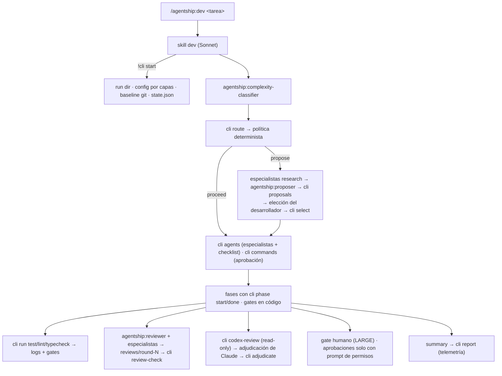

# Arquitectura

## Piezas

| Archivo | Rol |
|---|---|
| `.claude-plugin/plugin.json`, `marketplace.json` | Manifiesto y marketplace (`agentship@agentship`). |
| `skills/dev/SKILL.md` | Orquestador. `approve`, `approve-command` y `exception` no están pre-autorizados. |
| `agents/*.md` | classifier, proposer, planner, implementer, reviewer. |
| `src/routing/` | Clasificación, política y flags de la petición. |
| `src/proposals/` | Validación y elección de propuestas. |
| `src/agents/` | Registro de agentes y matcher por dominio y fase. |
| `src/engine/plan.ts` | Validación del plan y de las waves. |
| `src/config/config.ts` | Configuración por capas, perfiles, tiers y escalamiento; regla de que el proyecto solo endurece la política. |
| `src/state/state.ts` | Fases por ruta, transiciones, gates de inicio y reintentos. |
| `src/gates/commands.ts` | Comandos declarados, aprobaciones fuera del repo y ejecución con timeout y log. |
| `src/gates/review.ts` | Validación y agregación de revisiones; excepciones. |
| `src/git/tree.ts` | Línea base, detección de cambios externos y diff de la ejecución. |
| `src/integrations/codex/codex.ts` | Detección, adapter read-only, parseo y adjudicación. |
| `src/telemetry/telemetry.ts` | Eventos, reporte y comparación de perfiles. |
| `src/cli.ts` | Subcomandos; siempre imprime JSON. |

## Decisiones

- **El LLM propone y el código decide.** Toda salida de un LLM (clasificación, propuestas, plan, revisiones, Codex, adjudicación) se valida antes de usarla. El progreso vive en `state.json`, no en la memoria del modelo.
- **Las aprobaciones tienen a un humano en el bucle.** Los subcomandos que registran aprobaciones no están en `allowed-tools`, así que Claude Code muestra un prompt de permisos. `--resume … --approve` lo escribe el desarrollador.
- **Los comandos se ejecutan solo con aprobación.** Un comando declarado por el repo necesita que el desarrollador apruebe esa línea exacta. La aprobación se guarda fuera del repo, de modo que un repositorio malicioso no puede aprobarse a sí mismo.
- **El proyecto solo puede endurecer la política.** `agentship.config.json` es contenido no confiable.
- **Codex es independiente pero no se le cree a ciegas.** Corre read-only, se verifica que no haya modificado nada, y cada hallazgo se adjudica.
- **El texto del ticket nunca toca el shell.** Se escribe en archivos. El único comando que pasa por shell es el comando aprobado del proyecto y, en Windows, el shim de Codex con argumentos internos citados.
- **No hay commits, push ni PR.** AgentShip deja los cambios en el working tree y un `summary.md` listo para el PR.
- **No hay dependencias en runtime.** Node ≥ 22.18 ejecuta TypeScript directamente.
