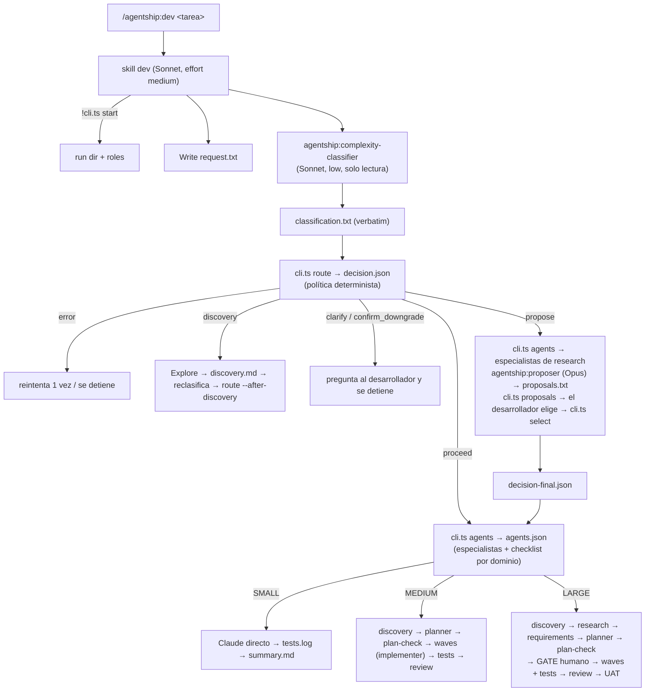

# Arquitectura (v0.2)

## Piezas

| Archivo | Rol |
|---|---|
| `.claude-plugin/plugin.json` | Manifiesto. El namespace es `agentship`. |
| `skills/dev/SKILL.md` | Orquestador. Corre inline para poder lanzar subagentes desde el nivel superior. |
| `agents/complexity-classifier.md` | Clasifica complejidad, riesgo, confianza, `domains` y `multiple_approaches`. Solo lectura. |
| `agents/proposer.md` | Ofrece de 1 a 3 enfoques, cada uno con su propia clasificación. Solo lectura. |
| `agents/planner.md` | Criterios de aceptación, decisiones y waves en JSON. Solo lectura. |
| `agents/implementer.md` | Ejecuta una wave aprobada y sus tests. Sin commits. |
| `agents/reviewer.md` | Revisa el diff contra los criterios y los checklists. Solo lectura. |
| `src/routing/classification.ts` | Contrato §5.3 (+ `domains`, `multiple_approaches`) y validación. |
| `src/routing/policy.ts` | Decide `{action, route, risk, reasons}`: pisos de riesgo por dominio y disparadores de propuestas. Sin LLM. |
| `src/routing/request.ts` | Flags al inicio de la petición, incluido `--resume <run_id> --proposal <n>`. |
| `src/proposals/proposals.ts` | Valida las propuestas y calcula la clasificación de la propuesta elegida. |
| `src/agents/registry.ts` | Descubre agentes del proyecto, del usuario, de plugins instalados (p. ej. VoltAgent) y de AgentShip. |
| `src/agents/matcher.ts` | (dominio × fase) → agente especialista + modelo del rol. Determinista. |
| `src/engine/plan.ts` | Valida el plan del planner: waves con archivos, verificación y dependencias solo hacia atrás. |
| `src/cli.ts` | `start`, `route`, `proposals`, `select`, `agents` y `plan-check`. Siempre imprime un objeto JSON. |
| `config/default-policies.json` | Pisos de riesgo, riesgo mínimo por dominio y disparadores de propuestas. |
| `config/default-models.json` | Roles → modelo y effort. |
| `config/domain-packs.json` | Por dominio: los agentes que se buscan por fase y su checklist. |

## Decisiones

- **El LLM propone y el código decide.** Clasificador, proposer y planner devuelven JSON. El CLI lo valida y la ruta la fija `policy.ts`.
- **El texto del ticket nunca toca el shell.** Se escribe con la herramienta Write en `request.txt`. El `run_id` de `--resume` se valida con una expresión regular estricta, así que no puede salir de `.agentship/runs/`.
- **La ruta final es la mayor entre:** la complejidad, la recomendación del clasificador, el piso del riesgo y un override que la suba. El riesgo es el mayor entre el del clasificador, el mínimo de sus dominios y `--risk high`.
- **Las propuestas reducen alcance, no riesgo.** La propuesta elegida puede bajar la complejidad y la ruta, pero su riesgo es como mínimo el del análisis. Las propuestas no saltan la confirmación de downgrade ni el manejo de confianza LOW.
- **Motor de fases nativo, sin GSD.** GSD exigía `.planning/ROADMAP.md`, cambiaba de namespace según cómo se instalara e imponía commits propios. Las fases que usábamos (discovery, plan, gate, ejecución, verificación) ahora son subagentes de Claude Code con artefactos en `run_dir`. Nunca hay commits ni push.
- **Especialistas opcionales, checklist siempre.** Si hay un agente especialista instalado, se usa. Si no, `general-purpose` cumple ese papel con el mismo modelo. El checklist del dominio se aplica en ambos casos. El orden de preferencia es proyecto > usuario > plugin > AgentShip.
- **El modelo lo decide la fase, no el agente.** El matcher asigna el modelo del rol (`domain_research`, `domain_review`) y la skill lo pasa al delegar. El effort solo se puede fijar en el frontmatter del agente.
- **Sin dependencias en runtime.** Node ≥ 22.18 ejecuta TypeScript directamente.
- **Los artefactos viven en `.agentship/`,** que tiene un `.gitignore` propio con `*`.
