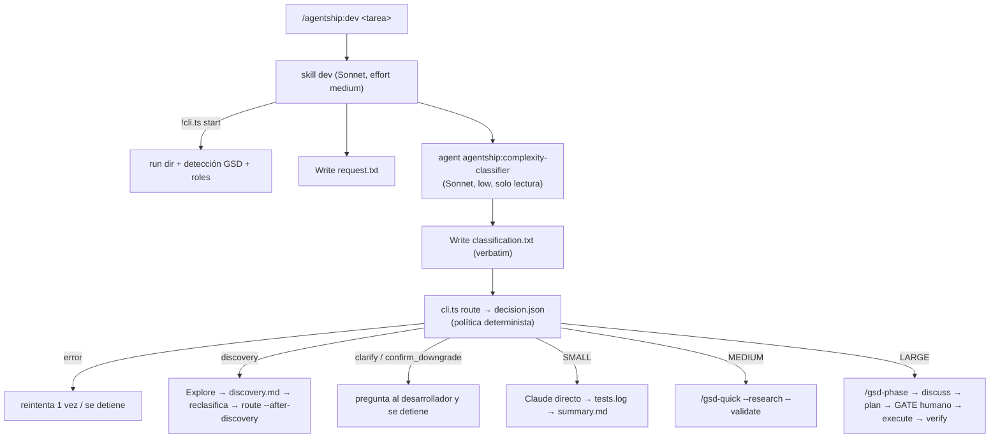

# Arquitectura (v0.1)



## Piezas

| Archivo | Rol |
|---|---|
| `.claude-plugin/plugin.json` | Manifiesto. El namespace es `agentship`. |
| `skills/dev/SKILL.md` | Orquestador. Corre inline (sin `context: fork`) porque los skills de GSD deben lanzar subagentes desde el nivel superior. |
| `agents/complexity-classifier.md` | Clasificador. Herramientas `Read, Grep, Glob`: no puede editar ni ejecutar nada. |
| `src/routing/classification.ts` | Contrato §5.3 y validación del JSON del clasificador. Tolera prosa y bloques ```json alrededor. |
| `src/routing/policy.ts` | Decide `{action, route, risk, reasons}`. Sin LLM. |
| `src/routing/request.ts` | Lee los flags al inicio de la petición. Un flag inválido es un error, nunca un valor por defecto. |
| `src/integrations/gsd/detect.ts` | Detecta cómo está instalado GSD (proyecto, usuario o plugin), su versión, el nombre real de los comandos y si existe `ROADMAP.md`. |
| `src/cli.ts` | `start`, `route` y `detect`. Siempre imprime un objeto JSON. |
| `config/default-*.json` | Política y roles de modelo por defecto. |

## Decisiones

- **El texto del ticket nunca toca el shell.** La skill lo escribe con la herramienta Write en `request.txt`, y el CLI lo lee como archivo. Hay un test de integración con `$(...)`, backticks y `;` que lo comprueba.
- **La ruta final es la mayor entre:** la complejidad, la recomendación del clasificador, el piso del riesgo (HIGH → LARGE) y un override que suba la ruta. La falta de información (confianza LOW) lleva a discovery y luego a aclaración, nunca a una ruta menor.
- **Bajar de ruta una tarea HIGH:** sin `--confirm-downgrade` devuelve `confirm_downgrade`. Con la confirmación, el mínimo sigue siendo MEDIUM, de modo que HIGH nunca corre como SMALL.
- **No se duplica GSD.** AgentShip solo decide y delega; el planner, executor y verifier son los de GSD, con sus propios modelos (perfil `balanced`: planner en Opus, executor en Sonnet).
- **Sin dependencias en runtime.** Node ≥ 22.18 quita los tipos de TypeScript al vuelo (`erasableSyntaxOnly`). `typescript` y `@types/node` son solo dependencias de desarrollo, para el typecheck.
- **Los artefactos viven en `.agentship/`,** con un `.gitignore` propio que contiene `*`.
